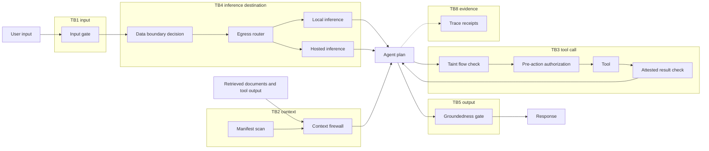
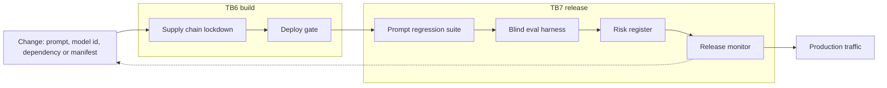
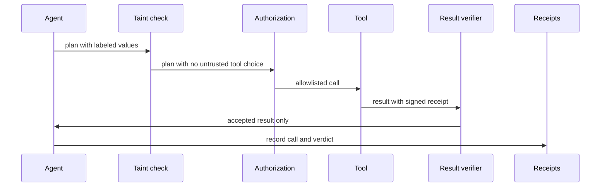

# Architecture

A reference architecture for shipping one LLM feature safely. It is a design composed from sixteen public repositories under `github.com/mpuodziukas-labs/`. Each repository does one narrow thing and proves it with a planted failure. This document says where each one sits, what it enforces, and what happens when it breaks. Every statement about a component comes from that repository's own README.

## Trust boundaries

| Id | Boundary |
|---|---|
| TB1 | Untrusted user input enters the request path |
| TB2 | Untrusted content (documents, tool output, tool manifests) enters agent context |
| TB3 | An agent decision becomes a side effect, and a tool result returns to the agent |
| TB4 | A prompt leaves for an inference destination, local or hosted |
| TB5 | Model output reaches the user |
| TB6 | A dependency or build change enters the artifact |
| TB7 | A release candidate meets production traffic |
| TB8 | Runtime events become audit evidence |

## Request path

## Release path

## One tool call

## Components

Posture is how this architecture wires the component, not a claim about the repository in isolation.

| Component | Repo | Boundary | Enforces | Failure mode | Posture |
|---|---|---|---|---|---|
| Input gate | `llm-adversarial-gate` | TB1 | Checks inputs against labeled attack patterns and blocks them before they reach the model | An attack outside the labeled patterns passes; the README lists known gaps | fail-closed |
| Data boundary | `llm-data-boundary` | TB4, TB8 | Decides ALLOW, REDACT-THEN-ALLOW or DENY per request from recorded provider attributes; unknown, stale, contradictory or malformed input is DENY; writes a hash-chained record per decision | A stale provider record yields a wrong but recorded decision | fail-closed |
| Egress router | `sensitivity-egress-router` | TB4 | Classifies the prompt first and picks the destination second; cost decides only among destinations the class allows; refuses when local is down | Over-blocks some benign prompts to local; the README reports the count | fail-closed |
| Context firewall | `context-injection-firewall` | TB2 | Scans text before it enters agent context and returns PASS, QUARANTINE or BLOCK | An injection class outside the tested classes is not seen | fail-closed |
| Manifest scan | `mcp-manifest-scan` | TB2 | Flags shell access, wide filesystem scope, literal secrets, hidden instructions, duplicate tool names and unpinned packages in a tool manifest | Static only: no server is started, so runtime behavior is not seen | fail-closed |
| Taint flow check | `taint-flow-guard` | TB3 | Blocks a plan whose tool choice or sensitive argument derives from untrusted data, whatever the wording | Only as good as the policy file that declares sensitive arguments | fail-closed |
| Pre-action authorization | `pre-action-authorization` | TB3 | Allows a tool call only if it is on the allowlist; the shell class is an allowlist of commands, not a denylist of verbs | A call class missing from the policy is denied, which costs availability | fail-closed |
| Attested result check | `attested-tool-results` | TB3 | Accepts a tool result only when its signed receipt is valid, fresh, unseen and tied to a call the agent issued | A tool that cannot produce a receipt has all its results rejected | fail-closed |
| Groundedness gate | `rag-groundedness-gate` | TB5 | Each claim sentence must cite a retrieved document with an exact quote that is really in it, and every number must appear in the quote | Checks the cheap, checkable half only; it does not judge claims that carry no figures or quotes | fail-closed |
| Trace receipts | `agent-trace-receipts` | TB8 | Writes a tamper-evident chain keyed by a secret you hold; the verifier refuses a bad chain | A missing or short key is refused, so tracing stops until the key is fixed | fail-closed |
| Supply chain lockdown | `supply-chain-lockdown` | TB6 | Flags unpinned dependencies, missing integrity hashes, install scripts and unpinned CI steps | A pattern outside its tested classes is not seen | fail-closed |
| Deploy gate | `k8s-deploy-gate` | TB6 | Checks probes, resource limits, non-root and pinned tags offline before deploy | Covers the listed rules only; it does not see a running cluster | fail-closed |
| Prompt regression suite | `prompt-regression-suite` | TB7 | Lints versioned prompt templates and fails the build when a new version regresses a case an older version passed | Scores recorded responses, so it cannot see behavior the recording does not cover | fail-closed |
| Blind eval harness | `blind-eval-harness` | TB7 | Scores a guard as a black box on cases it never saw; a crash or timeout counts as the guard's own flag; lists every miss | The score is only as representative as the held-out set | fail-closed |
| Risk register | `ai-risk-register` | TB7 | Recomputes risk scores from evidence files and refuses on missing, stale, contradicted or tampered evidence | Synthetic evidence in the README; a real system needs its own evidence bundle | fail-closed |
| Release monitor | `llmops-release-monitor` | TB7 | Eval-gated promotion, canary rollback, drift and cost monitoring, tamper-evident audit log | Live monitoring is wired fail-open: an outage of the monitor does not stop traffic, and promotion of new versions is blocked until it returns | fail-open |

## Reading the table

- Every boundary above appears in at least one row, so no boundary is left without an owner.
- The one fail-open row is a choice, written down in ADR 0002: serving traffic on the last released version is safer than refusing all traffic, and nothing new ships while monitoring is down.
- Cost and latency for the whole path are modeled in `capacity/`, with prices you supply.
- Multi-agent build work follows the director and executor pattern in `orchestrator/`, described in ADR 0003.
