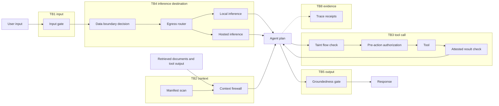

# AI assurance reference architecture

[](https://github.com/mpuodziukas-labs/ai-assurance-reference-architecture/actions/workflows/ci.yml)

Proves: AI systems architecture. A reference design for shipping one LLM feature safely, composed from public repositories under `github.com/mpuodziukas-labs/`, with runnable checks on the parts that live in this repository.

The design answers one question: for each way an LLM feature can hurt you (hostile input, planted instructions in documents, an unapproved tool call, data sent to the wrong destination, an invented number in an answer, a bad release, a tampered audit trail), which small, testable component stops it, and what does it do when it breaks?

## Request path

Each box is one public repository; each TB is a trust boundary. The release path and the tool-call sequence are in `ARCHITECTURE.md`.



## What is here

- `ARCHITECTURE.md`: diagrams for the request path, the release path and one tool call; eight trust boundaries; one table mapping each component to its repository, what it enforces, its failure mode, and whether it is wired fail-open or fail-closed.
- `adr/`: eight decision records (status, context, decision, alternatives considered, consequences, trade-offs).
- `capacity/`: a deterministic token, cost and latency model driven by a YAML file. Prices are inputs you supply.
- `orchestrator/`: a small director and executor orchestrator over mock agents, with token budgets, disjoint file lanes and a verifier that rejects a lane that overspends or touches another lane's files.
- `scripts/arch-lint.py` and `scripts/verify.sh`: the checks that keep the documents and code honest.

## Run it in 60 seconds

```
python3 -m pip install pytest pyyaml
bash scripts/verify.sh
bash scripts/verify.sh --selftest
```

`verify.sh` runs the tests, lints the architecture document and ADRs, runs the cost model on the example twice and requires byte-identical output, runs the orchestrator demo, and prints `GREEN` only if all of them pass. `--selftest` plants four defects (an ADR missing a section, an unknown repository in the table, a budget breach that is accepted, a negative cache rate that is accepted) plus one clean control and prints `selftest 5/5` only if each defect is caught and the control passes.

Cost model on its own:

```
python3 capacity/cost_model.py capacity/example.yaml
```

## Honesty Statement

- This is a design composed from the listed repositories. It is not a deployed system and has no production results. The description of each component comes from that repository's own README.
- Prices in `capacity/example.yaml` are illustrative. Supply your own. Output numbers are only as good as your inputs.
- The orchestrator uses mock agents. It proves the control logic (budgets, lane ownership, re-verification), not the quality of any real agent.
- No framework certification or legal compliance is claimed.

## Limitations

- The architecture document is checked for structure (sections, known repository names, balanced diagrams, boundaries present in the table), not for whether the design is the right one for your system.
- The cost model uses the sum of stage p95 values as a conservative upper bound on end-to-end latency. It is not a queueing model and does not model concurrency or retries.
- Cache behavior is simplified: a hit skips the model call and has a flat per-request cost plus a fixed monthly cost.
- Each component has its own documented known gaps. Read its README before relying on it.

## License

MIT. See `LICENSE`.
